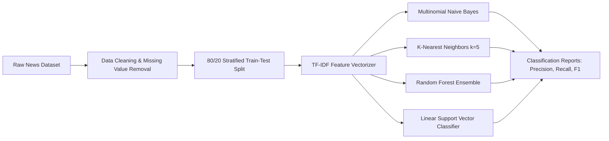

# Fake News Detection & NLP Classification Pipeline 📰🔍

### Machine Learning Benchmark for Misinformation Detection using TF-IDF and Supervised Classifiers

[](https://www.python.org/)
[](https://scikit-learn.org/)
[](https://pandas.pydata.org/)
[](https://jupyter.org/)
[](https://en.wikipedia.org/wiki/Tf%E2%80%93idf)
[](https://opensource.org/licenses/MIT)

This project implements a complete Natural Language Processing (NLP) pipeline to detect and classify fake news articles. It benchmarks multiple supervised machine learning architectures against term-frequency inverse document frequency (TF-IDF) feature representations.

---

## 📊 Pipeline Architecture



---

## 🔬 Methodology & Model Comparison

1. **Data Preprocessing:**
   - Cleans unstructured text and eliminates empty or corrupt records.
   - Normalizes text corpus to prevent sparse representation distortion.

2. **Feature Extraction (TF-IDF):**
   - Transforms n-gram text distributions into weighted numerical vectors:
     $$	ext{TF-IDF}(t, d, D) = 	ext{TF}(t, d) 	imes \log\left(rac{|D|}{1 + |\{d \in D : t \in d\}|}
ight)$$
   - Penalizes common stopwords while amplifying highly discriminative topical vocabulary.

3. **Benchmarked Classifiers:**
   - **Multinomial Naive Bayes (`MultinomialNB`):** Highly effective probabilistic baseline for text classification assuming conditional word independence.
   - **K-Nearest Neighbors (`KNeighborsClassifier`):** Instance-based non-parametric classifier evaluating distance metrics in vector space.
   - **Random Forest (`RandomForestClassifier`):** Ensemble decision tree architecture robust against feature correlation and overfitting.
   - **Linear Support Vector Classifier (`SVC(kernel='linear')`):** Maximum-margin linear hyperplane separator optimizing decision boundary in high-dimensional sparse feature spaces.

4. **Evaluation Metrics:**
   - Evaluated using Scikit-Learn `classification_report`:
     - **Precision:** Exactness of positive fake news flags (reducing false alarms).
     - **Recall:** Sensitivity to catching deceptive misinformation.
     - **F1-Score:** Harmonic balance between precision and recall.

---

## 🚀 Running the Notebook

### Prerequisites

Ensure Python 3.9+ is installed along with the required scientific libraries:

```bash
pip install pandas numpy scikit-learn jupyter
```

### Execution

1. **Clone the repository:**
   ```bash
   git clone https://github.com/Amrit-04/Fake-Newz-Detection-ML-model.git
   cd Fake-Newz-Detection-ML-model
   ```

2. **Launch Jupyter:**
   ```bash
   jupyter notebook "ML Project.ipynb"
   ```

3. **Run all cells** to reproduce data preprocessing, model fitting, and evaluation reports.

---

## 📁 Repository Structure

```
Fake-Newz-Detection-ML-model/
├── ML Project.ipynb     # Complete notebook with data prep, TF-IDF, and 4 models
└── README.md            # Project documentation and benchmark explanation
```

---

## 📄 License

This project is licensed under the MIT License.